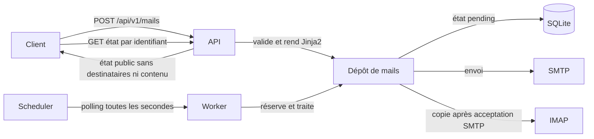

# Architecture

Alertiny sépare la réception des demandes HTTP de leur livraison. L'API valide et met en file les notifications dans SQLite; un scheduler et son worker récupèrent les éléments dus, puis délèguent l'envoi au client SMTP/IMAP.

## Parcours d'une notification



1. `src/api/v1/mails.py` reçoit les requêtes sous `/api/v1/mails`. La création valide le modèle de requête, puis retourne HTTP 202 avec un identifiant et l'état initial.
2. `src/repositories/mails/repo.py` vérifie le template autorisé dans `src/config/templates.yaml`, valide les variables requises, rend le sujet et le HTML, puis persiste la notification.
3. `src/scheduler/main.py` initialise la base, réconcilie les tâches interrompues, puis appelle `MailWorker` chaque seconde. `src/repositories/worker.py` traite au plus 25 messages dus par lot.
4. `MailsRepository` réserve chaque notification par une mise à jour conditionnelle afin d'éviter qu'un autre worker ne traite simultanément le même identifiant.
5. `src/repositories/mails/client.py` envoie le message via SMTP et, après acceptation, le copie dans le dossier IMAP configuré. Un échec de copie IMAP est enregistré sans déclencher un nouvel envoi SMTP.

## Composants et configuration

- `src/application.py` construit l'application FastAPI, initialise le schéma au démarrage et fournit `/health`.
- `src/security.py` protège les routes de l'API avec `ALERTINY_BEARER_TOKEN`; `/health` est exemptée pour permettre les contrôles de santé.
- `src/params/mails.py` combine `src/config/config.yaml` avec les identifiants SMTP/IMAP provenant de l'environnement. Les identifiants IMAP peuvent reprendre ceux de SMTP.
- `src/params/database.py` configure SQLAlchemy. Par défaut, la base est `/data/alertiny.db`; `ALERTINY_DATABASE_URL` peut remplacer cette URL. SQLite est la base prévue pour le déploiement V1.
- `src/supervisor/supervisord.conf` lance et supervise l'API et le scheduler dans le conteneur. Un seul scheduler doit utiliser une base SQLite donnée.

## États et reprises

```text
pending -> sending -> sent
                  -> pending (retry SMTP différé)
                  -> failed (retries épuisés)
failed -> pending (relance manuelle)
```

`sending` est un état courant transitoire, réservé par le worker; les événements d'historique de la table `status` utilisent `pending`, `sent`, `failed` ou `unknown`. Les erreurs SMTP incrémentent le compteur et déclenchent un backoff exponentiel plafonné à une heure. Lors d'un refus partiel, seuls les destinataires refusés sont réessayés. Au démarrage, les notifications restées en `sending` sont remises en file.

Après acceptation SMTP de tous les destinataires, Alertiny passe la notification à `sent` et efface les adresses, le corps rendu et les valeurs du template. La copie IMAP est ensuite enregistrée séparément. Comme le serveur SMTP et SQLite ne partagent pas de transaction, une interruption entre ces deux opérations peut rendre l'issue incertaine et causer un doublon lors de la reprise.

Pour le détail des colonnes et des règles de conservation, voir le [modèle de données](../src/models/db/README.md). Pour les commandes de construction et d'exploitation, voir le [guide de déploiement Podman](deploiement.md).
