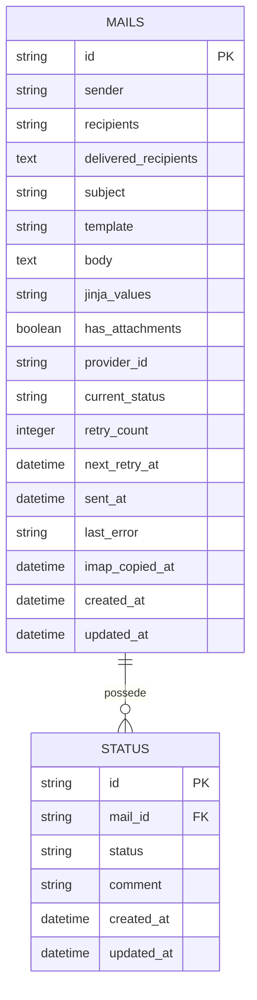

# Modèle de données

La V1 utilise deux tables SQLAlchemy, `mails` et `status`, dans une base SQLite par
défaut (`/data/alertiny.db`). Chaque notification possède un identifiant UUID; son
historique de statuts est conservé séparément.

## Table `mails`

| Colonne | Type logique | Rôle |
| --- | --- | --- |
| `id` | chaîne (UUID, 36 caractères) | Clé primaire et identifiant de suivi. |
| `sender` | chaîne (255) | Expéditeur enregistré. |
| `recipients` | chaîne (255) | Destinataires restant à livrer ou à réessayer. |
| `delivered_recipients` | texte | Destinataires acceptés pendant une livraison partielle. |
| `subject` | chaîne (255) | Sujet rendu à l'ajout en file. |
| `template` | chaîne (255) | Nom ou chemin logique du template utilisé. |
| `body` | texte nullable | HTML rendu, effacé après acceptation SMTP complète. |
| `jinja_values` | chaîne (255) | Valeurs du template nécessaires aux retries. |
| `has_attachments` | booléen | Indicateur réservé; les pièces jointes sont refusées en V1. |
| `provider_id` | chaîne (255) | Identifiant du message utilisé pour l'en-tête `Message-ID`. |
| `current_status` | chaîne (20) | État courant, notamment `pending`, `sending`, `sent` ou `failed`. |
| `retry_count` | entier | Nombre de retries SMTP déjà effectués. |
| `next_retry_at` | date-heure nullable | Prochaine échéance d'envoi différé. |
| `sent_at` | date-heure nullable | Heure d'acceptation SMTP. |
| `last_error` | chaîne (255) nullable | Dernière erreur SMTP ou IMAP, tronquée à 255 caractères. |
| `imap_copied_at` | date-heure nullable | Heure de confirmation de la copie IMAP. |
| `created_at`, `updated_at` | date-heure | Horodatages communs aux modèles. |

La clé primaire `id` est indexée. `current_status` est une projection du dernier état
utile à la sélection dans la file; elle n'est pas la source de l'historique.

## Table `status`

| Colonne | Type logique | Rôle |
| --- | --- | --- |
| `id` | chaîne (UUID, 36 caractères) | Clé primaire de l'événement. |
| `mail_id` | chaîne (UUID, 36 caractères) | Clé étrangère vers `mails.id`, indexée. |
| `status` | chaîne | Valeur contrainte à `pending`, `sent`, `failed` ou `unknown`. |
| `comment` | chaîne (255) nullable | Détail facultatif d'une erreur ou d'une reprise. |
| `created_at` | date-heure | Date de création de l'événement, utilisée pour l'ordre historique. |
| `updated_at` | date-heure | Horodatage commun au modèle. |

La relation est de un-à-plusieurs : une ligne `mails` peut avoir plusieurs événements
`status`. La suppression d'un mail entraîne la suppression en cascade de son historique.
L'ORM ordonne les statuts par `created_at` et applique `delete-orphan` à la relation.

## Cycle de vie et conservation

- À la mise en file, les destinataires, le corps rendu et les valeurs Jinja sont
    enregistrés pour permettre la livraison et les retries.
- Après refus SMTP partiel, les destinataires acceptés et ceux restant à livrer sont
    suivis séparément. Seuls les destinataires refusés sont retentés.
- Après acceptation SMTP complète, `recipients`, `delivered_recipients`, `body` et
    `jinja_values` sont vidés. Les métadonnées et les événements de statut restent présents.
- Après épuisement des retries, les destinataires non livrés restent disponibles pour
    une relance manuelle; ils ne sont donc pas effacés à la fin de chaque tentative.
- Une erreur de copie IMAP n'annule pas l'état SMTP `sent` et ne provoque pas de nouvel
    envoi. Elle est conservée dans `last_error` et dans un événement `sent` commenté.

La V1 n'effectue pas de purge automatique des lignes de notification ou d'historique.
L'effacement des données de livraison après succès réduit la conservation des données
personnelles, mais ne signifie pas que toute la ligne est supprimée.

## Initialisation et mises à niveau

`initialize_database()` dans `src/params/database.py` crée les tables manquantes et
ajoute, si nécessaire, les colonnes V1 suivantes à une table `mails` existante :
`body`, `delivered_recipients`, `current_status`, `retry_count`, `next_retry_at`,
`imap_copied_at` et `last_error`. La fonction recalcule ensuite `current_status` depuis
le statut le plus récent lorsque l'historique le permet. Cette initialisation idempotente
est exécutée au démarrage de l'API et du scheduler; il n'y a pas de système de migrations
versionnées séparément dans le dépôt.
